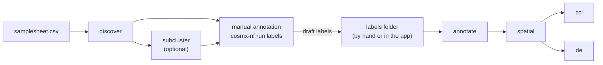

# CosMx-Nf

A Nextflow (DSL2) pipeline for single-cell spatial transcriptomics from the Bruker (NanoString)
CosMx Spatial Molecular Imager. It takes each slide's flat-file export through QC, integration,
clustering and reference-based cell typing. A human-in-the-loop annotation step follows, then
spatial statistics, cell-cell communication and neighbourhood-aware differential expression.
Every step is an R script in `bin/` built on [Giotto](https://giottosuite.com).

It was written for multi-sample FFPE kidney biopsy studies on the CosMx 6K Discovery panel. The
marker panel (`assets/canonical_markers.csv`) and the default reference profiles are
kidney-specific. The rest of the pipeline is tissue-agnostic.

## How a run proceeds

The pipeline runs in stages. Each stage is its own launch (`cosmx-nf <run_id> <stage>`) and picks
up the Giotto object the previous stage published, so the manual annotation step can sit between
them.



| Stage | Processes | Methods |
|---|---|---|
| `discover` (default) | LOAD, QC, MERGE, INTEGRATE, CLUSTER, CLUSTER_CHECKS, HIERATYPE, INSITUTYPE, SUPERVISED, DIAGNOSTICS | Giotto `importCosMx`, with negative probes as their own feature type. Per-sample QC: the count floor is `min(count_cap, count_quantile)`, so it never removes more than a set share of a sample. Also an area cap, an FOV flag and border-cell flags. Normalisation, then the genes picked by `hvg_method` unioned with the marker panel, then PCA, then Harmony over the batch columns that vary. A shared-nearest-neighbour graph is clustered with Leiden over a resolution ladder, with UMAPs for the chosen resolutions. Checks on those choices: a cluster tree, the silhouette and each cluster's stability for every resolution, and the resolution the stability picks. HieraType marker typing. Unsupervised InSituType with cohorts from the immunofluorescence channels and neighbourhood expression. Supervised InSituType against reference profiles. Marker-panel diagnostics per chosen column and the picked one write a label template with a best guess per cluster. |
| `subcluster` | SUBCLUSTER, DIAGNOSTICS | Re-embeds each cluster of a basis column on its own (own HVGs, PCA, Harmony, graph, Leiden) and adds one `sub_<res>` column. Clusters below `subcluster_min_cells` are left whole. |
| manual annotation | `cosmx-nf <run_id> labels` | Knits `manual_annotation.Rmd` in the container. It covers resolution overview, marker heatmaps and volcano plots, marker-score-guided draft labels, lineage and immunofluorescence checks, and a validation against the annotate contract. It writes a `cluster_id,label` CSV for you to curate. |
| `annotate` | APPLY_LABELS, COMPOSITION, BUNDLE | Joins the run's curated cluster labels onto their clustering (`cell_type`, `cell_type_l1`) and draws a marker dot plot. The per-cell edits in the same folder go on top. A low-confidence edit leaves `cell_type` alone: it changes only the label figures draw (`cell_type_display`, striped) and marks the cell in `label_confidence`. Composition per sample, with the per-subject change against a baseline inside each treatment group. |
| `spatial` | SPATIAL_NET, BANKSY_PREP, BANKSY_SAMPLE, BANKSY, BCELL, IMMUNE_DENSITY | A Delaunay network with a maximum edge length, and cell-type proximity enrichment per sample against a permutation null. BANKSY niches per sample, one task each, on the variable genes that rise well above the sample's background, then matched across samples into niche types by their cell-type mix (`niche_type_lam<lambda>`). The settings are the `banksy_settings` row of `assets/banksy_variants.csv`. B-lineage subclustering. Immune cells per mm² of occupied tissue. |
| `cci` | CCI_LIANA, CCI_NICHENET, CCI_MISTY, CCI_MISTY_COLLECT, CCI_SPARKX, CCI_NNSVG, CCI_INSITUCOR | LIANA ligand-receptor consensus weighted by Delaunay contact. NicheNet ligand activity per comparison and receiver type. MISTy intra, juxta and para views per sample. SPARK-X spatially variable genes beyond cell-type composition, refined with nnSVG. InSituCor spatial co-expression modules. |
| `de` | SMIDE, SMIDE_OVERLAP, SMIDE_META, PSEUDOBULK_DE | smiDE per sample x cell type (a GLMM on niche type, with neighbour-expression and spatial terms), pooled across samples by fixed-effect meta-analysis. Hits whose gene is far higher in neighbouring cells of that niche are flagged as possible transcript bleed. Pseudobulk edgeR per cell type, each later timepoint against baseline within subject, with the same bleed flag. |
| `banksy_sweep` | BANKSY_SWEEP_PREP, BANKSY_SWEEP, BANKSY_SWEEP_COLLECT | Optional. Runs each biopsy through every row of `assets/banksy_variants.csv`, with the same code as the `spatial` stage, and scores the niches: agreement with FOVs (low is better), with cell types, and spatial coherence. For choosing `banksy_settings`. |
| `checks` | CLUSTER_CHECKS | Runs the discovery checks on the discover object: the cluster tree, the silhouette, and the stability check that picks a resolution (`checks_stability`, on by default). On request it also estimates how many PCs the data supports (`checks_dims`), and compares the gene-selection methods (`checks_genes`). That comparison includes NanoString's per-cluster method and writes each method's genes, so a list can go back into a rerun with `--hvg_method file --hvg_file`. |
| `diagnose` | DIAGNOSTICS | Re-runs the diagnostics on existing columns without recomputing anything upstream. |
| `supervised` | SUPERVISED, DIAGNOSTICS | Re-runs the supervised InSituType passes against the published discover object. |
| `report` | REPORT | Rebuilds the HTML report from the published results. |

Every stage ends by rebuilding the HTML report in `results/report/` (open `index.html`). It has a
page per step, from samples and QC to the CCI and DE hits, with their figures and tables, and a
Run status page.

## Requirements

- Linux with [Apptainer](https://apptainer.org) 1.1 or later. Every task runs inside one image
  that holds R 4.5, Giotto 4.2, every R package the pipeline loads, Giotto's Python, and the
  Quarto that builds the HTML report.
  `cosmx-nf setup` downloads it (2.8 GB) from GitHub's container registry. Its recipe and lock
  files are in `Environment/`, to rebuild it.
- [Nextflow](https://www.nextflow.io) 24.04 or later (the configuration uses `resourceLimits`),
  which needs Java 17 or later. Developed on 26.04, where `nextflow lint` reports no errors.
- Reference profiles for the supervised passes and the NicheNet model files. `cosmx-nf setup`
  downloads or builds them, and `Environment/README.md` lists their sources.

## Setup

Once per machine:

```bash
git clone https://github.com/CharitidisKP/CosMx-Nf.git ~/cosmx-nf
~/cosmx-nf/cosmx-nf install   # links cosmx-nf into ~/.local/bin
cosmx-nf setup                # the image, the references, conf/site.yaml
```

- `install` prints the line to add to `~/.bashrc` when `~/.local/bin` is not on your PATH.
- `setup` keeps the image in `images/`. `--images <folder>` puts it elsewhere, `--sif <file>`
  uses one you already have and `--no-references` skips the reference files. It never
  overwrites an existing `conf/site.yaml`.
- If your data or projects sit outside your home folder, list them under `bind` in
  `conf/site.yaml` so the tasks can read them.

Then one folder per project:

```bash
cosmx-nf init ~/my_study      # cosmx-nf.yaml, samplesheet.csv and Runs/
```

Fill in `samplesheet.csv` (see [Samplesheet](#samplesheet)). Run from inside the folder. There,
cosmx-nf keeps the runs in the project's `Runs/`, launches Nextflow in the project folder, and
reads its `cosmx-nf.yaml` on top of `conf/site.yaml`. A parameter set in `cosmx-nf.yaml`
applies to that project only.

## Running

From the project folder:

```bash
cosmx-nf run1 discover
cosmx-nf run1                             # where the run stands, and the next command
cosmx-nf run1 labels                      # draft labels for the pick
# curate the labels, by hand or in the app
cosmx-nf run1 cci                         # runs annotate and spatial first
cosmx-nf run1 de
```

The pick is the Leiden resolution the stability check chose (see
[Choosing the Leiden resolution](#choosing-the-leiden-resolution)). `labels <clustering>` drafts
another one. To split every cluster of a resolution into subclusters, and label those instead
(without `--subcluster_basis`, the pick):

```bash
cosmx-nf run1 subcluster --subcluster_basis leiden_clus_res0.3
cosmx-nf run1 labels sub_res0.3
```

`cosmx-nf <run_id> <stage> [options]` launches one stage:

- **Resuming** is the default. A stage resumes its own last launch for the run. It starts fresh
  when there is none, when the object it reads was rebuilt since, or with `--fresh`. Tasks use
  `cache = 'lenient'` (path and size, not timestamps), so a shared file system with unreliable
  timestamps does not invalidate the cache.
- **Options** are Nextflow's (`-profile slurm`) or the pipeline's (`--seed 7`). A `--param`
  that no config declares is refused, because Nextflow otherwise accepts a mistyped one
  silently. The profile defaults to `profile:` in the settings, else `server`.
- **work/** goes to local scratch (`$NXF_SCRATCH_ROOT`, default `/tmp/$USER-nf`), linked from
  the run folder. Launch long stages in tmux or screen. cosmx-nf warns when you do not.
- **`cosmx-nf <run_id>`** shows each stage's last launch and result. It marks a stage outdated
  when its results predate a rebuild of the object it reads, checks the labels against the
  annotate object, and names the next command.
- **Labels** live in `Runs/<run_id>/labels/`, the folder the Shiny app edits:
  - `cluster_labels.<clustering>.csv` (`cluster_id,label`) for each clustering you label
  - `label_overrides.csv` (`cell_ID,label,confidence,note`) for per-cell edits
  - `cluster_basis.txt`, naming the clustering `cell_type` comes from. It is needed only when
    more than one clustering has labels.

  `cosmx-nf <run_id> labels` knits `notebooks/manual_annotation.Rmd` in the image and copies its
  draft there, never over a file you curated. `annotate` needs no flags. `--labels`,
  `--label_overrides` and `--cluster_basis` each replace one file, and `--labels_dir` points at
  another folder.
- **Changed labels** are picked up on their own. `annotate` and `spatial` record the labels
  their objects were built from (`label_state.txt`). When a later stage finds the labels
  changed, it reruns `annotate`, and `spatial` if needed, first in the same launch. `spatial`
  also reruns when `banksy_settings` changes.
- **The HTML report** in `results/report/` is rebuilt at the end of every stage. Open
  `results/report/index.html` in a browser, from where it sits, because its pages link the
  figures and tables in `results/`. It has a page per step from 01 to 09, and a page per method
  where a step has several (reference typing, spatial, cell-cell communication and DE), with an
  overview and a run status page. Each page folds how its outputs were made into a box at the
  top, and lists the settings behind them with the comment each has in `nextflow.config`.
- **The report's figures** are drawn by the report itself with ggplot2, in the pipeline's deck
  style (`bin/cosmx_figures.R` and `label_colours`), from the run's tables and, for the UMAPs,
  the app bundle. Each is kept in `results/report_figures/` and drawn again only when its
  tables change. The tissue maps, the cluster tree and the marker dot plot are the pipeline's
  own, and each page folds the figures the pipeline wrote into a list. Figures wider than 2,400
  px are shown as smaller copies, kept in `results/report_display/`.
- **The report's tables** can be searched and filtered, show at most 5,000 rows (those with the
  smallest p value) and link the full CSV. The site is built from `report/` with Quarto inside
  the image. If it fails to build, the stage still finishes and `results/report/` keeps the last report.
- **`de`** tests every typed label in `cell_type`, one smiDE job per sample and cell type, unless
  `smide_celltypes` names a subset.
- **`--solo <id,id|all>`** also takes the named samples through discovery on their own, without
  MERGE or Harmony (`--solo_only` skips the merged run).
- **`--merged_giotto <dir>`** points any stage after `discover` at a different Giotto object
  than the one the previous stage published.
- **`assets/samplesheet.smoke.csv`** loads three FOVs per sample, for a quick end-to-end check
  of `discover`.

Without cosmx-nf, a stage is one Nextflow launch:

```bash
nextflow run main.nf -profile server -params-file conf/site.yaml \
  --outdir Runs/run1/results --run_id run1 --stage discover
```

### Choosing the Leiden resolution

`discover` clusters every resolution in `leiden_res_ladder`, and its stability check picks one:

- It re-clusters 80% of the cells three times at each resolution and scores every cluster by its
  best Jaccard overlap with the new clusters.
- The pick is the resolution with the highest median Jaccard. A tie goes to the coarser one.
- It is written to `tables/03_clustering/checks/picked_resolution.txt` and marked in
  `resolution_checks.csv`, on `resolution_checks.png` and on the report's Clustering page. It
  gets marker diagnostics and a UMAP like the `chosen_resolutions`.

The pick is used only where no clustering is named:

- `cosmx-nf <run_id> labels` drafts labels for it.
- `subcluster` without `--subcluster_basis` splits it.
- `diagnose` without `--diag_columns` includes it.
- `cosmx-nf <run_id>` names it in the next command.

It never writes `labels/cluster_basis.txt`, so `annotate` uses the clustering you labelled.

The check is on by default and is the slowest part of `discover`: about 3.5 h on 148,000 cells
with the default ladder, run beside HieraType and InSituType. To skip it, pass
`--checks_stability false` or set `checks_stability: false` in the project's `cosmx-nf.yaml`.
That `discover` then leaves no pick. `cosmx-nf <run_id> checks` runs the check later on the
discover object.

### Profiles

| Profile | What it sets |
|---|---|
| `server` | Local executor on one large machine, every task in the Apptainer image, per-task and total CPU/memory caps. |
| `slurm` | The same container settings with the SLURM executor, a time limit per resource label and `--partition`. |

Resources are set per label in `conf/base.config`. A task that dies with a kill or
out-of-memory exit code is retried once with twice the memory.

## Samplesheet

One row per sample, as in `assets/samplesheet.csv`. The real sheets, which carry data paths,
belong outside git: point `input` in `conf/site.yaml` at them (`assets/private/` is gitignored).

| Column | Meaning |
|---|---|
| `sample_id` | Unique sample name, used in every output and by `--solo`. |
| `include` | `TRUE`/`FALSE`. `FALSE` drops the sample from every stage without deleting its row. A missing column counts as `TRUE`. |
| `file_prefix` | Prefix of the flat files in `data_dir` (`<prefix>_exprMat_file.csv.gz`, `<prefix>_metadata_file.csv.gz`, ...). |
| `data_dir` | The sample's flat-file export folder: expression matrix, cell metadata, FOV positions and polygons. Absolute, or relative to the launch directory. |
| `patient_id` | Specimen or patient code, stored on every cell. Use a study code, never a hospital or accession number. |
| `treatment` | Study group. Comparisons stay inside each group (`compare_within`). |
| `timepoint` | Compared against `compare_baseline` (`compare_by`). |
| `slide_id`, `batch` | Physical slide and instrument run. With `batch_column` these are the Harmony covariates. |
| `subset_fovs` | Optional. Semicolon-separated FOV ids to load, for when several samples share one slide's export. |
| `subject_id` | Optional. The person. Paired changes in `annotate` and NicheNet are computed within a subject (`pair_by`). |

## Configuration

Every parameter is declared, with a comment, in `nextflow.config`, grouped by step. The ones
most runs touch:

| Parameter | Default | |
|---|---|---|
| `input` | `assets/samplesheet.csv` | Samplesheet. `cosmx-nf init` sets the project's. |
| `chosen_resolutions` | `0.3,0.5` | Leiden resolutions that get a UMAP and diagnostics. Every resolution in `leiden_res_ladder` is still clustered. |
| `hvg_method` | `variance` | How the PCA's genes are picked: `variance` (scran's top `n_hvgs`), `variance_batch` (the same within batches), `all`, or `file` with `hvg_file`. The marker panel is always added. |
| `checks_stability` | `true` | Re-clusters 80% of the cells three times and picks the Leiden resolution. See [Choosing the Leiden resolution](#choosing-the-leiden-resolution). |
| `checks_dims`, `checks_genes` | `false` | The slower discovery checks on the PCs and the gene selection. `checks = false` skips the whole step. |
| `markers` | `assets/canonical_markers.csv` | Marker panel (`cell_type,compartment,gene`) behind the diagnostics and HVG union. |
| `supervised_profiles` | `HCA_Kidney,KPMP` | Reference profiles for supervised InSituType, resolved in `profile_dir`. |
| `compare_by`, `compare_baseline`, `compare_within`, `pair_by` | `timepoint`, `T0`, `treatment`, `subject_id` | The study design, read from the samplesheet by composition and NicheNet. |
| `celltype_column` | `cell_type` | Label used by `spatial`, `cci` and `de`. Any typing column works. |
| `untyped_celltypes` | `Low_count` | Labels without a cell identity: kept in the object, left out of LIANA, NicheNet and the typed proportions. |
| `label_colours` | `assets/label_colours.csv` | Colour, group (immune, non_immune or untyped) and display name of each label, for every figure and the app. |
| `fig_format` | `png` | Formats of the label and niche figures: `png`, `pdf`, `jpeg`, a comma list, or `all`. Tissue maps are always PNG. |
| `banksy_settings` | `docs_above_background` | The row of `assets/banksy_variants.csv` the `spatial` stage runs. |

Machine-specific settings (the image, its Python, bind mounts, the profile, reference folders)
go in `conf/site.yaml`, which `cosmx-nf setup` writes. `conf/site.example.yaml` lists every key.
A project's `cosmx-nf.yaml` sets its own samplesheet and can override any of them. Both are
params files rather than `-c` configs, because params set in a `-c` file do not reach the
profile settings built from them.

## Outputs

```
<project>/Runs/<run_id>/             or Runs/<run_id>/ beside the pipeline, outside a project
├── labels/                            curated labels: cluster_labels.<clustering>.csv, label_overrides.csv, cluster_basis.txt
├── results/
│   ├── report/                        the HTML report, rewritten at the end of every stage: open index.html
│   ├── report_figures/                the report's own figures, drawn again when their tables change
│   ├── report_display/                smaller copies of the large figures, for the report
│   ├── figures/<step>/                01_qc ... 09_de
│   ├── tables/<step>/                 CSVs by the same steps, draft labels in 06_annotation/labels/
│   ├── objects/<stage>/giotto         discover, subcluster, annotate, spatial, solo/<id>
│   ├── pipeline_info/                 <stage>_{report.html,trace.txt,timeline.html,params.json}, stage_log.tsv
│   └── local_export/                  Shiny bundle, written by annotate (or cosmx-nf <run_id> bundle)
├── logs/                              nextflow.log, and settings.yaml with a project launch's merged settings
└── work -> <scratch>/<run_id>
```

The discovery checks write to `02_integration/checks` and `03_clustering/checks`, where
`picked_resolution.txt` names the picked clustering.

Steps: `01_qc`, `02_integration`, `03_clustering`, `04_reference_typing`, `05_subclustering`,
`06_annotation`, `07_spatial`, `08_cci`, `09_de`. The BANKSY sweep writes under
`07_spatial/banksy_sweep`. Each launch also records its parameters (`<stage>_params.json`) and a
line in `stage_log.tsv` with the time, the pipeline commit and the command line.

## Repository layout

```
main.nf            entry workflow: stage checks, one named workflow per --stage, run records
nextflow.config    parameters, profiles, reports, manifest
conf/              base.config (resources), server.config, slurm.config, site.example.yaml
subworkflows/      discovery, solo, annotation (ANNOTATION, SPATIAL, DE), cci and samplesheet helpers
modules/           one process per file (insitutype_supervised.nf holds SUPERVISED and ATTACH_SUPERVISED)
bin/               the R scripts the processes call
assets/            marker panel and example samplesheets
notebooks/         manual_annotation.Rmd and render.sh, the manual annotation step, and positron_kernel.sh, Positron's R console in the image
shiny/             interactive explorer and label editor for a run (see shiny/README.md)
report/            the HTML report: a Quarto page per step or method, its helpers, figures and styles
tests/             testthat tests for the label rules, the app's labels and the report's helpers, test_cosmx-nf.sh for the launcher, test_in_image.sh for the helpers
Environment/       the image: recipe, R and Python lock files, build, reference downloads, smoke test, and in_image.sh, which runs a command in it as the stages do
cosmx-nf           launcher: install, setup, init, stages, status, labels, bundle
```

## Shiny explorer

`shiny/` is an app for browsing a run and curating its labels. It has UMAP and tissue views
coloured by any annotation, gene expression, depth-matched gene co-detection, and the
diagnostics and label tables side by side. Cluster labels and per-cell edits (high or low
confidence) are saved to the run's labels folder as you make them, and the next stage applies
them. The app runs where the results are, for example from Positron or RStudio on the server,
and opens the run launched last. In a project, set `COSMX_NF_RUNS=<project>/Runs` before
starting it. The annotate stage writes a bundle of the cells, expression and cell outlines
next to the results (`bundle = false` turns it off), so the app never loads Giotto.
`cosmx-nf <run_id> bundle` exports one from another object. Without
a bundle it falls back to synthetic data from `make_demo.R`.

## Limitations

- CosMx exports are large and patient-derived, so the repository ships no test data. The
  smoke samplesheet shows the shape of a minimal run.
- There is no CI yet. `tests/testthat` covers the label rules, the app's label handling and the
  report's helpers
  (`Rscript -e 'testthat::test_dir("tests/testthat")'`), `tests/test_cosmx-nf.sh` the
  launcher and `tests/test_in_image.sh` the helpers that run in the image. The rest is checked with
  `nextflow lint`, a parse check of every `bin/` script, and by running the affected stages.
- The marker panel and default profiles assume kidney tissue.

## Acknowledgements

Built on Giotto, InSituType, HieraType, Harmony, BANKSY, LIANA, NicheNet, MISTy, SPARK-X,
nnSVG, InSituCor and smiDE. Please cite the methods you use.

## License

MIT, see [LICENSE](LICENSE).
